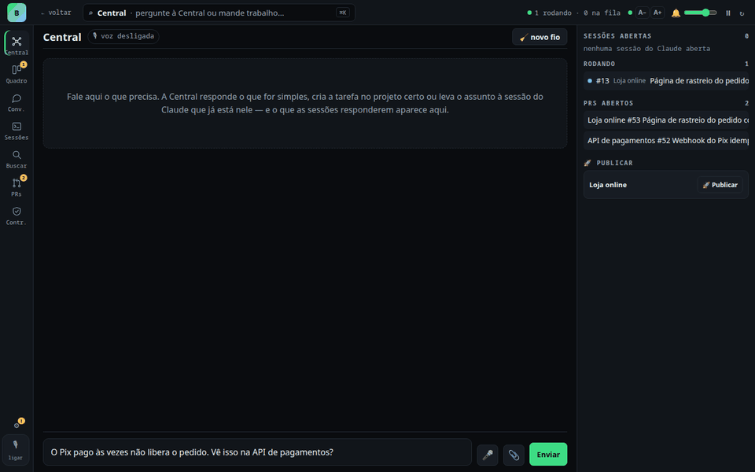
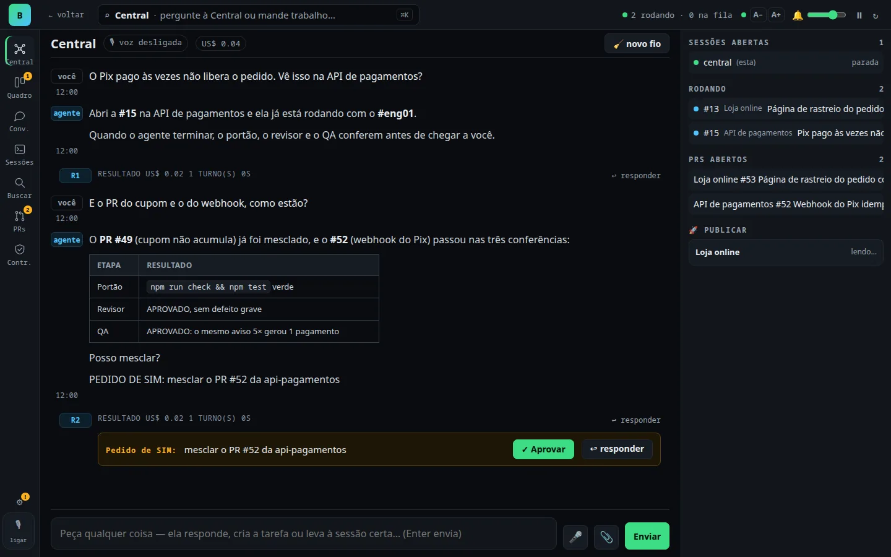
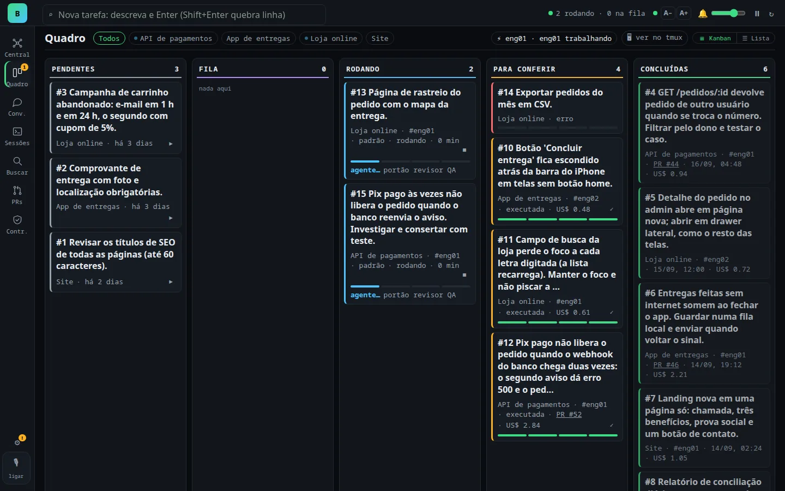
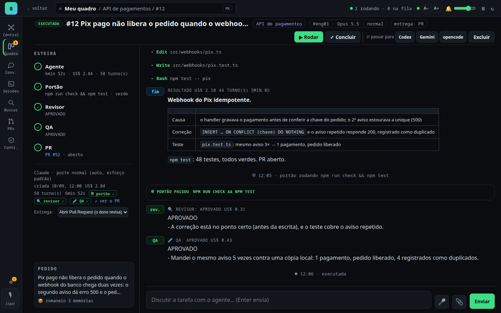
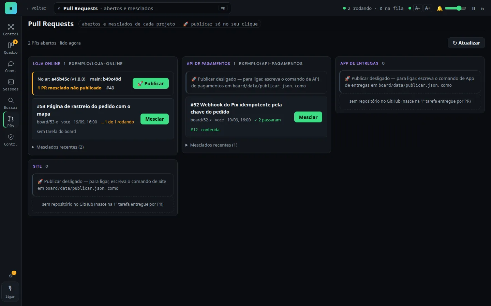
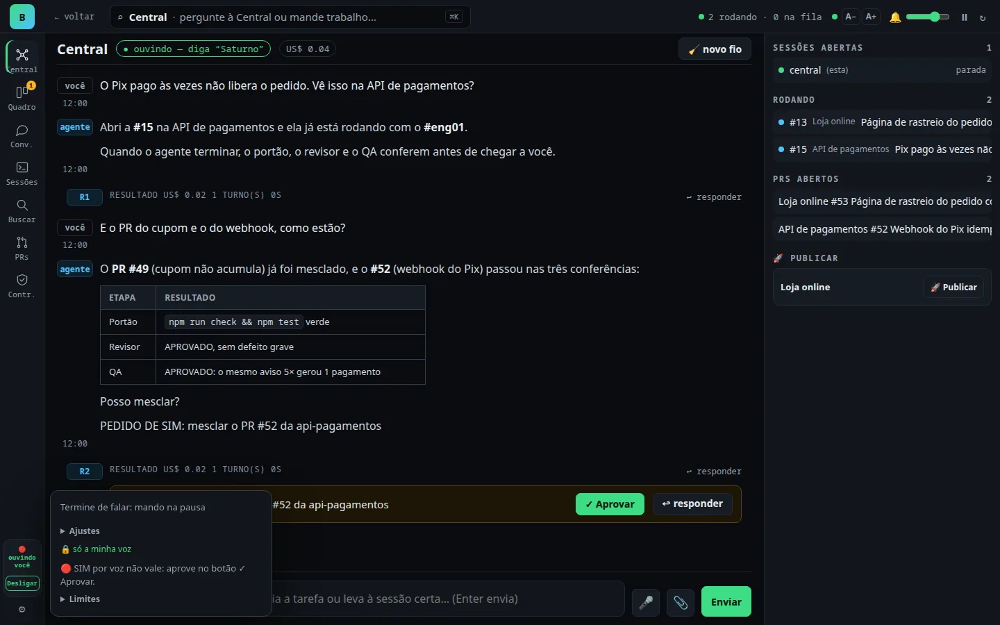
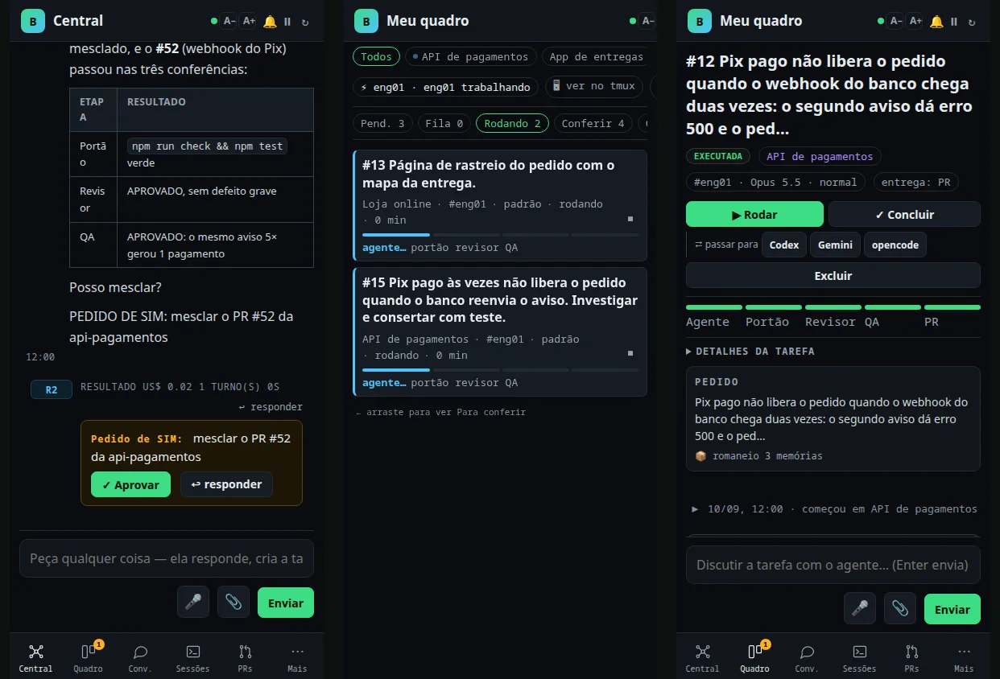
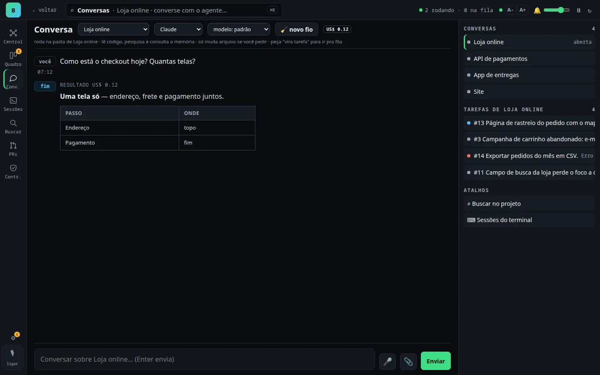

# board

[](LICENSE)
[](https://github.com/gilvanecesar/board-agentes/releases)
[](https://github.com/gilvanecesar/board-agentes/pkgs/container/board-agentes)
[](https://github.com/gilvanecesar/board-agentes/actions/workflows/testes.yml)
[](https://nodejs.org)
[](package.json)

[Português](README.md) · **English**

### You talk to a Central (typing or by voice) and it hands the work to AI agents that check each other, all on your machine.

Ask the way you would ask a person. The Central turns the request into a task in the right project, an agent
(Claude Code, Codex, Gemini or opencode) works in that folder, and **nothing reaches you without three checks**: the
project's own tests, a reviewer that reads the diff, and a QA that runs it and tries to break it. When something needs
your YES (merging a PR, say), it asks, and your ✓ Approve becomes a **signed, verifiable approval** any other session
can check.

Plain Node, **zero npm dependencies**, no board cloud: the server listens on `127.0.0.1` only.

The interface is in Brazilian Portuguese.



<sub>All images come from a **demo** board with fictional projects and data.</sub>

---

## Why use it

- **Stop being the context copier.** Instead of one terminal tab per project, repeating yourself, one conversation sends
  the work where it belongs.
- **You review less, because the board reviews first.** Every delivery that touches files goes through gate, reviewer
  and QA; a rejection goes back to the agent in the same session, with the full report.
- **You decide what matters, and only that.** Merging, publishing and anything production waits for your click. The
  agent never merges or deploys on its own.
- **Everything stays with you.** Code, tasks, memory, voice audio: on your machine. Nothing goes to a board service,
  because there isn't one.

---

## What it does

| | |
|---|---|
| 💬 **Central** | One screen where you talk and it delegates: answers the simple stuff, creates the task in the right project, or routes the topic to the Claude session already working on it. On the side: what's running, open PRs, and 🚀 Publish. |
| 🎙 **Voice mode** | Talk without pressing anything, on any screen, and hear the answer. whisper.cpp for transcription and Piper or Kokoro for speech, **all local**. Outside the Central, only speech that starts with the wake word you choose counts. Optional "only my voice" filter. |
| ✅ **Self-checking pipeline** | **Agent → gate → reviewer → QA** on every task that touches files. Each defect is **SERIOUS** (rejects, goes back to the agent) or **MINOR** (kept as a note, no extra round). No readable verdict never approves. |
| 🔏 **Verifiable approval** | The YES you give in the Central is stored with a signature. Another session checks it with `board aprovacao <id> "<request>"` → `✓ CONFERE` or `✗ NÃO VALE`. Only a clean YES to the exact request counts. A spoken YES never counts. |
| 🗂 **Kanban board** | Pending, Queue, Running, To check and Done, with each task's pipeline as four bars and one button per card. Or the list view, to drag the queue order. |
| 🔀 **PRs, watcher and 🚀** | Each project's PRs with checks, conflicts and the review verdict; **Merge** with a safety lock; a PR that falls into conflict goes back to its agent automatically; and 🚀 Publish, only by your click, with a live log. |
| ⚡ **Parallel agents** | Each task gets its own agent (`#eng01`, `#eng02`…) in an isolated copy (git worktree). Once approved, the board merges it back, three-way when needed. |
| 🔁 **Four engines, one baton** | Claude Code, Codex, Gemini (`agy`) and opencode. When one runs out of quota mid-task, the one with the most headroom takes over through a **written baton**: the request, the summary, the last steps and `git status`. |
| 🔐 **Permissions on screen** | When an agent asks for permission, a card shows up: allow once, always allow this kind, or deny. No answer means denied. |
| 🖥 **Sessions and tmux** | The terminal of each Claude session running in tmux, live and in color, inside the board. And one tmux tab per agent, showing the code it writes. |
| 🧠 **Memory that travels** | Hooked to [ai-memory](https://github.com/akitaonrails/ai-memory), the board picks, for each task, the right memories by keyword and by meaning, and sends them written in the request: the **picking list**. Works with any engine. How it works (in Portuguese): [docs/MEMORIA.md](docs/MEMORIA.md). |
| 📱 **On the phone** | Same screen, with a bottom bar. Through your VPN (e.g. Tailscale), away from home, without opening a port to the internet. |

---

## See it

**Central:** the conversation, the task it created, and the **YES request** with ✓ Approve.



**Board:** kanban with each task's pipeline.



**Task page:** the five-step pipeline (Agent, Gate, Reviewer, QA, PR), what the agent did, and the reports.



**Pull Requests:** checks, verdict, Merge, and 🚀 Publish with "live × main".



**Voice mode:** listening, with the panel at the foot of the menu. A spoken YES doesn't count: approving is a click.



**On the phone:** Central, board and task.



**Per-project conversation:** one thread per project, in its folder, to think things through before opening a task.



---

## The usual way × the board

| | Terminal tabs with one agent each | board |
|---|---|---|
| Many projects | one tab per project, you repeat context | one Central, it routes to the right project |
| Review | you read everything | gate + reviewer + QA before it reaches you |
| Rejection | you explain again | back to the agent in the same session, with the report |
| Quota ran out | the task stops | another engine takes over through the baton |
| Approval | "go ahead" typed anywhere | signed YES, verifiable by another session |
| Seeing what's going on | switching tabs | board, live task page, tmux, phone |
| Cost | the agent's | the agent's **plus** the checks (measured below) |

### Does it work? We measured (2026-09-27)

The same tasks, with **unwritten** business rules, given to Claude Code alone and to the board, same model, 3 runs
each, scored against a **hidden answer key** neither could see:

| | AI alone | board |
|---|---|---|
| Answer-key score | 54/60 | **59/60** |
| Perfect deliveries | 9/12 | **11/12** |
| Average cost per task | **US$ 0.25** | US$ 1.06 (4.2×) |
| Average time | **44 s** | 3min41 (5×) |

**Honest reading:** on a small, well-specified task, the model alone is enough and cheaper. The board pays off where
the rule isn't written down and mistakes are expensive (security, money, production). In a login task, the AI alone,
in all 3 runs, let one shared IP lock everyone out; the board's QA also caught a defect the answer key didn't even
measure. On small tasks with the rules written down it was a tie (12/12 on both sides), with the board costing 4.4×.

---

## Start in 2 minutes

### With Docker (Node, git, tmux and Claude Code included)

```bash
docker run -d --name board -p 127.0.0.1:4488:4488 \
  -e CLAUDE_CODE_OAUTH_TOKEN="$(cat ~/.claude-token)" \
  -v ~/projects:/projetos -v board-data:/app/data \
  ghcr.io/gilvanecesar/board-agentes:latest
```

Open **http://localhost:4488**. Each folder in `~/projects` becomes a project. Claude Code in the container needs
**one** credential: `CLAUDE_CODE_OAUTH_TOKEN` (to use your plan: `claude setup-token`) or `ANTHROPIC_API_KEY`.
There's also a [`docker-compose.yml`](docker-compose.yml). The image doesn't ship `gh` (PR delivery) or the voice engines.

### Or straight on your machine

```bash
cd ~/projects                     # folders next to the board become projects
git clone https://github.com/gilvanecesar/board-agentes board
cd board && ./board.sh            # http://localhost:4488 — no npm install
```

You only need **Node 20+**, **git** and a logged-in **[Claude Code](https://docs.claude.com/claude-code)**. The rest
turns on parts of the board:

| Tool | What it enables |
|---|---|
| [`gh`](https://cli.github.com), logged in | PR delivery, the Pull Requests menu, the PR watcher |
| `tmux` | the Sessions menu and one tab per agent |
| `ollama` + `bge-m3` | search and picking by meaning (without it, keyword search, and the screen says so) |
| `whisper.cpp` (`ggml-small-q5_1.bin`) + Piper or Kokoro | voice mode and dictation |
| `codex`, `agy`, `opencode` | extra engines; only what's installed shows up |
| [`ai-memory`](https://github.com/akitaonrails/ai-memory) | shared memory (setup in [`memoria/`](memoria/)) |

### From the terminal

```bash
board add "Fix the login button text" my-app --fila   # --pr delivers by PR · --paralelo gives it its own agent
board list · board show 1 · board say 1 "use the function that already exists"
board aprovacao <id> "<request>"     # checks a YES given in the Central
board tela quadro                    # switches the screen on the device you're using
board pausar · retomar · reiniciar · agentes
```

---

## FAQ

**Does it need internet or a board account?** There's no board account or server. The internet is the agents' own
(Claude Code, Codex…), each with its own account and terms.

**Is it safe to let agents run in my folders?** The screen listens on `127.0.0.1` only; click actions (publish,
approve, allow, type into a session) must come from the screen itself, so an agent's `curl` gets a 403. The agent
never merges or deploys; projects marked as production (`BOARD_PRODUCAO`) always work in a copy and deliver by PR.
It's a guard against accidents, not a vault: whoever opens the screen controls the folders. Don't expose the port.

**What if the agent gets it wrong?** The gate runs your project's tests, the reviewer reads the diff against the
request, and the QA runs it and tries to break it. Serious defects go back to the agent with the report. Even so, the
PR is yours to review.

**How much does it cost?** The board is free (MIT). You pay for the agents. The checks cost more: in our measurement,
~4× the cost and ~5× the time of the AI alone, in exchange for fewer defects reaching you.

**Does voice send my audio anywhere?** No: whisper.cpp and Piper/Kokoro run on your machine. It was tested with a
simulated microphone and synthetic voices; **not** with a real microphone or on Safari. And approval by voice never counts.

**Only Claude?** Claude Code is the default engine and the Central's. Codex, Gemini (`agy`) and opencode run tasks,
and reviewer and QA can be on a different engine than the agent (cross-checking).

**Windows?** Not tested. It's built and used on macOS and Linux.

---

## How it's built

| | |
|---|---|
| `board.mjs` + `servidor/` | the server, one module per topic (pipeline, queue, engines, Central, approvals, voice, PRs, sessions, permissions, memory…) |
| `web/` | the screen, no build step: HTML, CSS and one script per screen |
| `board-cli.mjs` | the `board` CLI |
| `test/` | the test suite (`npm test`, `node:test` only): the whole board in an isolated sandbox, with **fake** `claude`, `gh`, whisper and other engines speaking each one's real format, and the screen in a headless Chrome. No real agent, no cost. GitHub runs it on every PR |
| `memoria/` | the shared-memory setup: server, backup and mirror |

Rules: zero dependencies, one module per topic, Portuguese UI, English code.

---

## Credits

- **[ai-memory](https://github.com/akitaonrails/ai-memory)**, by **Fabio Akita** ([@akitaonrails](https://github.com/akitaonrails)), MIT:
  long-term memory shared across agents. The board **neither includes nor modifies** ai-memory.
- Engines: [Claude Code](https://docs.claude.com/claude-code) (Anthropic), [Codex](https://github.com/openai/codex)
  (OpenAI), Antigravity/`agy` (Google) and [opencode](https://github.com/sst/opencode). Voice:
  [whisper.cpp](https://github.com/ggml-org/whisper.cpp), [Piper](https://github.com/rhasspy/piper),
  [Kokoro-82M](https://huggingface.co/hexgrad/Kokoro-82M) and [sherpa-onnx](https://github.com/k2-fsa/sherpa-onnx).
  Each with its own license and terms.

License: [MIT](LICENSE).
