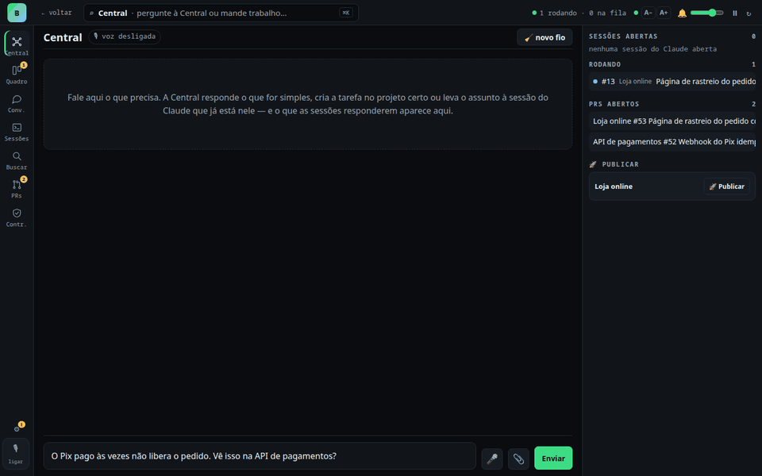
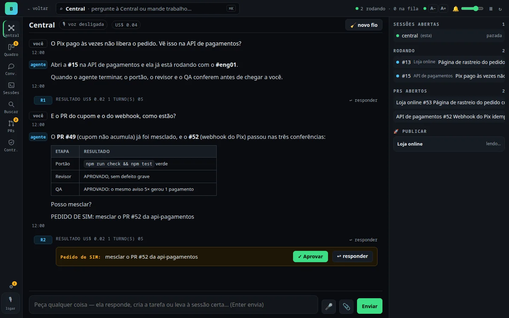
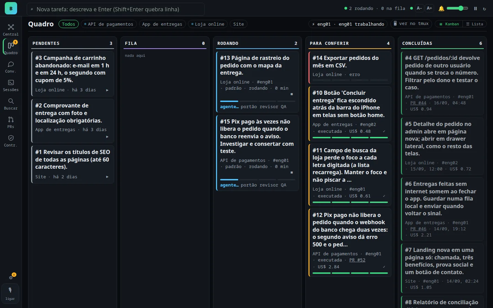
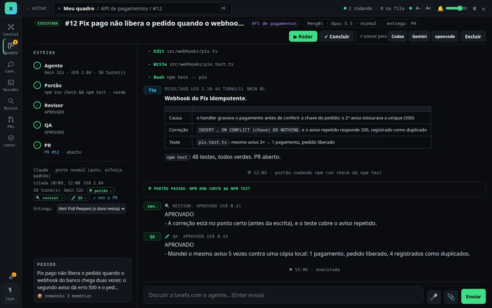
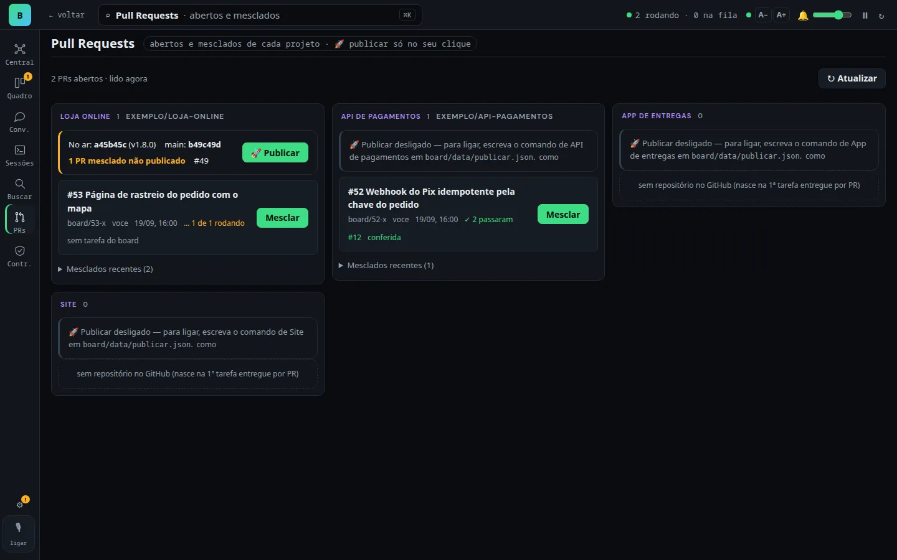
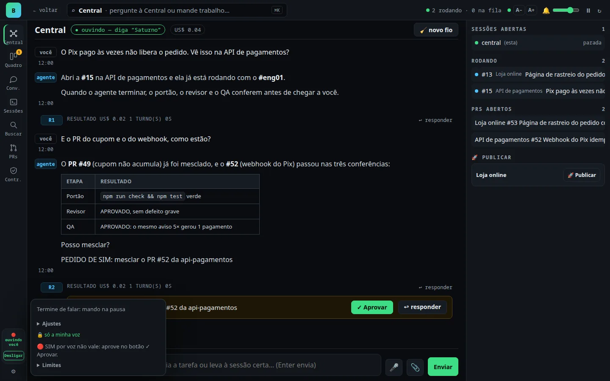
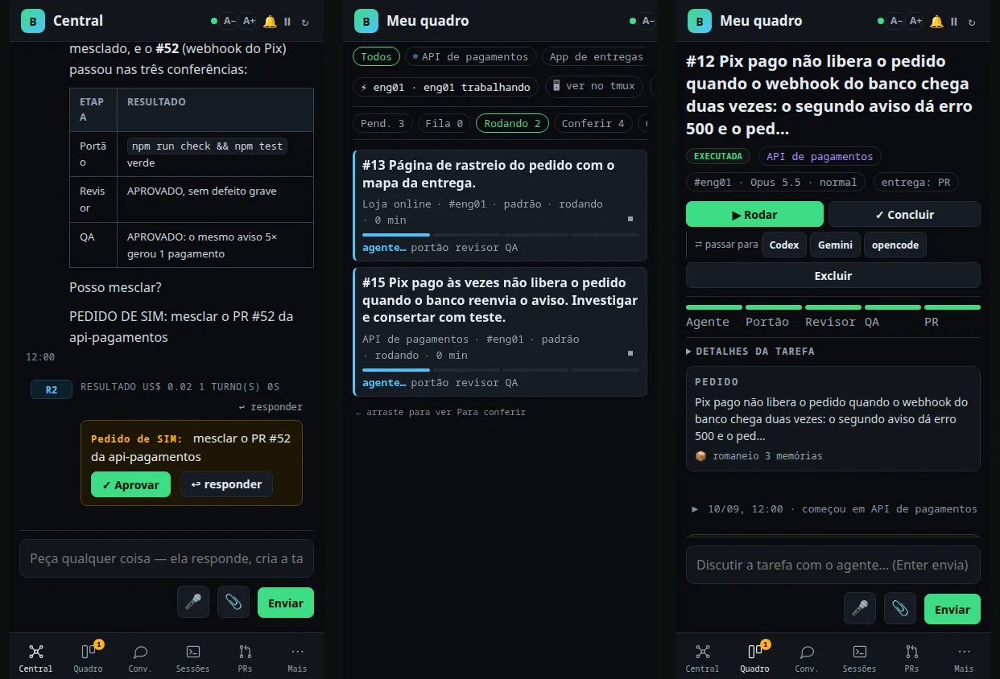
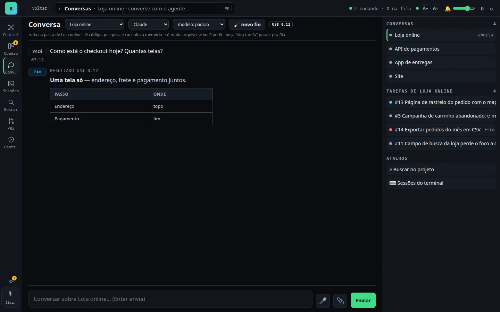

# board

[](LICENSE)
[](https://github.com/gilvanecesar/board-agentes/releases)
[](https://github.com/gilvanecesar/board-agentes/pkgs/container/board-agentes)
[](https://github.com/gilvanecesar/board-agentes/actions/workflows/testes.yml)
[](https://nodejs.org)
[](package.json)

**Português** · [English](README.en.md)

### Você fala com uma Central (escrevendo ou por voz) e ela distribui o trabalho para agentes de IA que se conferem sozinhos, tudo na sua máquina.

Peça em português, do jeito que você pediria a uma pessoa. A Central vira o pedido em tarefa no projeto certo, um
agente (Claude Code, Codex, Gemini ou opencode) trabalha na pasta, e **nada chega a você sem passar por três
conferências**: os testes do próprio projeto, um revisor que lê o diff e um QA que executa e tenta quebrar. Quando
alguma coisa precisa do seu SIM (mesclar um PR, por exemplo), ela pede, e o seu ✓ Aprovar vira uma aprovação
**assinada e conferível** por qualquer outra sessão.

Node puro, **zero dependência npm**, sem nuvem do board: o servidor escuta só em `127.0.0.1`.



<sub>Todas as imagens são de um board de **demonstração**, com projetos e dados fictícios.</sub>

---

## Por que usar

- **Você para de ser o copiador de contexto.** Em vez de uma aba de terminal por projeto, repetindo o que já disse,
  uma conversa só manda trabalho para onde ele tem de ir.
- **Você confere menos, porque o board confere antes.** Toda entrega que mexe em arquivo passa por portão, revisor e QA,
  e uma reprova volta para o agente consertar na mesma sessão, com o parecer inteiro.
- **Você decide o que importa, e só isso.** Mesclar, publicar e o que for de produção esperam o seu clique. O agente
  nunca mescla nem publica sozinho.
- **Fica tudo com você.** Código, tarefas, memória, áudio da voz: na sua máquina. Nada é enviado para um serviço do
  board, porque não existe um.

---

## O que ele faz

| | |
|---|---|
| 💬 **Central** | Uma tela onde você fala e ela distribui: responde o simples, cria a tarefa no projeto certo, ou leva o assunto à sessão do Claude que já está nele. Ao lado, o que está rodando, os PRs abertos e o 🚀 Publicar. |
| 🎙 **Modo voz** | Fale sem apertar nada, em qualquer tela, e ouça a resposta. Transcrição com whisper.cpp e fala com Piper ou Kokoro, **tudo local**. Fora da Central, só vale a fala que começa com o nome que você escolher. Filtro opcional "só a minha voz". |
| ✅ **Esteira que se confere** | **Agente → portão → revisor → QA** em toda tarefa que mexe em arquivo. Cada defeito vem como **GRAVE** (reprova e volta ao agente) ou **MENOR** (fica como observação, sem nova rodada). Sem veredito legível nunca aprova. |
| 🔏 **Aprovação conferível** | O SIM que você dá na Central é gravado com assinatura. Outra sessão confere com `board aprovacao <id> "<pedido>"` → `✓ CONFERE` ou `✗ NÃO VALE`. Vale só o SIM limpo ao pedido exato, com a mesma ação e o mesmo número. SIM por voz nunca vale. |
| 🗂 **Quadro kanban** | Pendentes, Fila, Rodando, Para conferir e Concluídas, com a esteira de cada tarefa em quatro riscos e um botão por cartão. Ou a lista, para arrastar a ordem da fila. |
| 🔀 **PRs, vigia e 🚀** | Os PRs de cada projeto com checks, conflito e o veredito da conferência; **Mesclar** com trava; PR que ficou em conflito volta sozinho para o agente atualizar; e o 🚀 Publicar, só pelo seu clique, com o log ao vivo. |
| ⚡ **Agentes em paralelo** | Cada tarefa ganha o próprio agente (`#eng01`, `#eng02`…) numa cópia isolada (git worktree). Aprovado, o board junta na pasta, por três vias quando precisa. |
| 🔁 **Quatro motores, um bastão** | Claude Code, Codex, Gemini (`agy`) e opencode. Acabou a cota de um no meio da tarefa, o que tem mais folga assume pelo **bastão escrito**: o pedido, o resumo, os últimos passos e o `git status`. |
| 🔐 **Permissões na tela** | Quando um agente pede permissão, aparece um cartão: permitir uma vez, sempre permitir este tipo, ou negar. Sem resposta, negado. |
| 🖥 **Sessões e tmux** | O terminal de cada sessão do Claude que roda no tmux, ao vivo e com cores, dentro do board. E uma aba de tmux por agente, mostrando o código que ele escreve. |
| 🧠 **Memória que viaja** | Ligado ao [ai-memory](https://github.com/akitaonrails/ai-memory), o board separa, para cada tarefa, as memórias certas por palavra e por sentido, e as manda escritas no pedido: o **romaneio**. Serve para qualquer motor. Como funciona: [docs/MEMORIA.md](docs/MEMORIA.md). |
| 📱 **No celular** | A mesma tela, com barra de baixo. Pela sua VPN (ex.: Tailscale), fora de casa, sem abrir porta na internet. |

---

## Veja

**Central:** a conversa, a tarefa criada e o **Pedido de SIM** com ✓ Aprovar.



**Quadro:** kanban com a esteira de cada tarefa.



**Ficha da tarefa:** a esteira em cinco passos (Agente, Portão, Revisor, QA, PR), o que o agente fez e os pareceres.



**Pull Requests:** checks, veredito, Mesclar e o 🚀 Publicar com "no ar × main".



**Modo voz:** ouvindo, com o painel no pé do menu. O SIM por voz não vale: aprovar é no botão.



**No celular:** Central, quadro e ficha.



**Conversa por projeto:** um fio por projeto, na pasta dele, para pensar junto antes de abrir tarefa.



---

## O jeito comum × o board

| | Abas de terminal com um agente | board |
|---|---|---|
| Vários projetos | uma aba por projeto, você repete o contexto | uma Central, ela leva para o projeto certo |
| Conferência | você lê tudo | portão + revisor + QA antes de chegar a você |
| Reprova | você explica de novo | volta ao agente na mesma sessão, com o parecer |
| Cota acabou | a tarefa para | outro motor assume pelo bastão |
| Aprovação | "pode" escrito em qualquer lugar | SIM assinado, conferível por outra sessão |
| Ver o que está acontecendo | trocar de aba | quadro, ficha ao vivo, tmux, celular |
| Custo | o do agente | o do agente **mais** a conferência (medido abaixo) |

### Funciona? Medimos (27/09/2026)

As mesmas tarefas, com regras de negócio **não escritas**, pedidas ao Claude Code sozinho e ao board, mesmo modelo,
3 rodadas cada, contra um **gabarito escondido** que nenhum dos dois via:

| | IA sozinha | board |
|---|---|---|
| Nota no gabarito | 54/60 | **59/60** |
| Entregas perfeitas | 9/12 | **11/12** |
| Custo médio por tarefa | **US$ 0,25** | US$ 1,06 (4,2×) |
| Tempo médio | **44 s** | 3min41 (5×) |

**Leitura honesta:** em tarefa pequena e bem especificada, o modelo sozinho basta e sai mais barato. O board se paga
onde a regra não está escrita e o erro custa caro (segurança, dinheiro, produção). Num teste de login, a IA sozinha
deixou, nas 3 rodadas, um IP compartilhado bloquear todo mundo; o QA do board ainda achou um defeito que o gabarito nem
media. Em tarefas pequenas com as regras escritas, deu empate (12/12 dos dois lados), com o board custando 4,4×.

---

## Comece em 2 minutos

### Com Docker (Node, git, tmux e o Claude Code juntos)

```bash
docker run -d --name board -p 127.0.0.1:4488:4488 \
  -e CLAUDE_CODE_OAUTH_TOKEN="$(cat ~/.claude-token)" \
  -v ~/projetos:/projetos -v board-data:/app/data \
  ghcr.io/gilvanecesar/board-agentes:latest
```

Abra **http://localhost:4488**. Cada pasta em `~/projetos` vira um projeto. O Claude Code no container precisa de
**uma** credencial: `CLAUDE_CODE_OAUTH_TOKEN` (para usar o seu plano: `claude setup-token`) ou `ANTHROPIC_API_KEY`.
Também há o [`docker-compose.yml`](docker-compose.yml). A imagem não traz `gh` (entrega por PR) nem os motores de voz.

### Ou direto na máquina

```bash
cd ~/projetos                     # as pastas ao lado do board viram projetos
git clone https://github.com/gilvanecesar/board-agentes board
cd board && ./board.sh            # http://localhost:4488 — não há npm install
```

Precisa só de **Node 20+**, **git** e o **[Claude Code](https://docs.claude.com/claude-code)** logado. O resto liga
partes do board:

| Ferramenta | O que liga |
|---|---|
| [`gh`](https://cli.github.com), logado | entrega por PR, menu Pull Requests, vigia de PR |
| `tmux` | o menu Sessões e uma aba por agente |
| `ollama` + `bge-m3` | busca e romaneio por sentido (sem ele, busca por palavra, e a tela avisa) |
| `whisper.cpp` (`ggml-small-q5_1.bin`) + Piper ou Kokoro | o modo voz e o ditado |
| `codex`, `agy`, `opencode` | motores extras; só aparece o que estiver instalado |
| [`ai-memory`](https://github.com/akitaonrails/ai-memory) | a memória compartilhada (montagem em [`memoria/`](memoria/)) |

### Pelo terminal

```bash
board add "Corrigir o texto do botão de login" meu-app --fila   # --pr entrega por PR · --paralelo dá agente próprio
board list · board show 1 · board say 1 "use a função que já existe"
board aprovacao <id> "<pedido>"      # confere um SIM dado na Central
board tela quadro                    # muda a tela do aparelho que você está usando
board pausar · retomar · reiniciar · agentes
```

---

## Perguntas

**Precisa de internet ou de conta no board?** Não existe conta nem servidor do board. A internet é a dos próprios
agentes (Claude Code, Codex…), cada um com a sua conta e os seus termos.

**É seguro deixar agentes rodando nas minhas pastas?** A tela só escuta em `127.0.0.1`; as ações de clique (publicar,
aprovar, permitir, digitar numa sessão) exigem vir da própria tela, então um `curl` de agente recebe 403. O agente
nunca mescla nem publica; projetos marcados como produção (`BOARD_PRODUCAO`) trabalham sempre numa cópia e entregam
por PR. É barreira contra acidente, não cofre: quem abre a tela manda nas pastas. Não exponha a porta na internet.

**E se o agente errar?** O portão roda os testes do seu projeto, o revisor lê o diff contra o pedido, e o QA executa e
tenta quebrar. Defeito grave volta para o agente com o parecer. Mesmo assim, o PR é seu para revisar.

**Quanto custa?** O board é grátis (MIT). Você paga os agentes. A conferência custa mais: na nossa medição, ~4× o
custo e ~5× o tempo da IA sozinha, em troca de menos defeito chegando a você.

**A voz manda meu áudio para algum lugar?** Não: whisper.cpp e Piper/Kokoro rodam na sua máquina. Foi testado com
microfone simulado e voz sintética; **não** com microfone real nem no Safari. E aprovação por voz nunca vale.

**Funciona só com o Claude?** O Claude Code é o motor padrão e o da Central. Codex, Gemini (`agy`) e opencode rodam
tarefas, e revisor e QA podem ser de outro motor que o agente (conferência cruzada).

**Funciona no Windows?** Não testamos. É desenvolvido e usado em macOS e Linux.

---

## Como é feito

| | |
|---|---|
| `board.mjs` + `servidor/` | o servidor, um módulo por assunto (esteira, fila, motores, Central, aprovações, voz, PRs, sessões, permissões, memória…) |
| `web/` | a tela, sem build: HTML, CSS e um script por tela |
| `board-cli.mjs` | a CLI `board` |
| `test/` | a bateria (`npm test`, só `node:test`): o board inteiro numa caixa isolada, com `claude`, `gh`, whisper e os outros motores **falsos** que falam o formato real de cada um, e a tela num Chrome sem janela. Sem agente de verdade, sem custo. O GitHub roda em todo PR |
| `memoria/` | a montagem da memória compartilhada: servidor, backup e espelho |

Regras: zero dependência, um módulo por assunto, interface em português, código em inglês.

---

## Créditos

- **[ai-memory](https://github.com/akitaonrails/ai-memory)**, de **Fabio Akita** ([@akitaonrails](https://github.com/akitaonrails)), MIT:
  a memória de longo prazo compartilhada entre os agentes. O board **não inclui nem modifica** o ai-memory.
- Motores: [Claude Code](https://docs.claude.com/claude-code) (Anthropic), [Codex](https://github.com/openai/codex)
  (OpenAI), Antigravity/`agy` (Google) e [opencode](https://github.com/sst/opencode). Voz:
  [whisper.cpp](https://github.com/ggml-org/whisper.cpp), [Piper](https://github.com/rhasspy/piper),
  [Kokoro-82M](https://huggingface.co/hexgrad/Kokoro-82M) e [sherpa-onnx](https://github.com/k2-fsa/sherpa-onnx).
  Cada um com a própria licença e os próprios termos.

Licença: [MIT](LICENSE).
